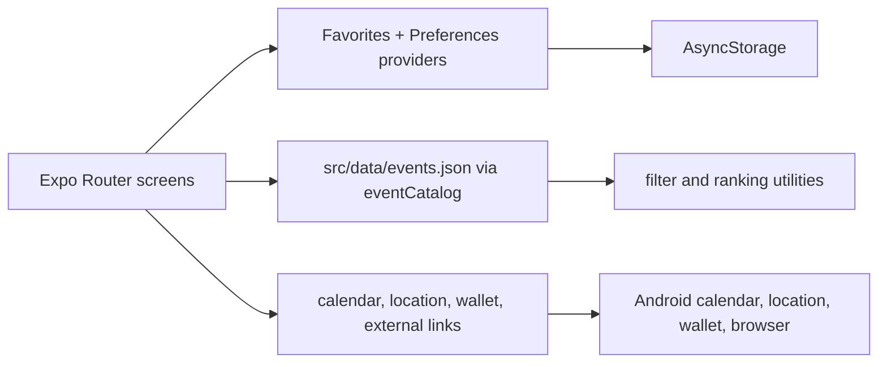

# Solwhere architecture

Solwhere is a client-only Expo SDK 57 application. It has no backend, database, remote catalog API, account system, or server-side authentication. The event catalog ships in the application bundle. Local user state uses AsyncStorage.

## Directory map

```text
app/                         Expo Router routes and screens
  (tabs)/                    Discover, Saved, Profile tabs
  event/[id].tsx             Event-detail route
  onboarding.tsx             First-run preference flow
  preferences.tsx            Preference editing
components/                  Root provider stack and shared app primitives
constants/                   Wallet identity and devnet endpoint configuration
src/components/              Feature UI, filters, cards, artwork, action dock
src/data/                    Bundled events.json, catalog accessors, communities, countries
src/domain/                  Event and preference types; filter rules
src/hooks/                   Filter state plus Favorites and Preferences providers
src/services/                Storage, wallet, calendar, location, external-link boundaries
src/utils/                   Dates, event status, saved grouping, ranking, haptics
assets/                      Fonts and application branding assets
```

## Routing and screen organization

`app/_layout.tsx` waits for preference hydration before choosing navigation. A first-run user sees `onboarding`; a returning user sees tabs. The root route redirects to Discover.

- **Discover** (`app/(tabs)/discover.tsx`) loads upcoming catalog entries, applies local search and filters, and optionally partitions ranked results into preference matches and chronological remainder.
- **Saved** (`app/(tabs)/saved.tsx`) resolves locally saved IDs against current catalog and groups future and past events by device date.
- **Profile** (`app/(tabs)/profile.tsx`) exposes local preferences and wallet authorization state. Preferences are never wallet-gated.
- **Event detail** (`app/event/[id].tsx`) renders catalog data, official source/register action, save action, and Android calendar action for non-ended events.
- **Onboarding and preferences** share `PreferenceEditor` and use same preference profile shape.



## State and persistence

`FavoritesProvider` owns saved event IDs. `PreferencesProvider` owns the completed preference profile, onboarding draft, current onboarding step, hydration state, and persistence errors. Both providers are mounted at the root; native builds also mount `MobileWalletProvider`.

Storage keys are versioned:

- `solana-events:favorites:v1`
- `solana-events:interests:v1`
- `solana-events:preferences:v2`
- `solana-events:onboarding:v1`

`loadPreferences()` reads legacy interests and migrates them into the v2 preference profile without deleting v1 data. It also normalizes stored location data. Onboarding writes a draft after each change; completion persists the profile before marking onboarding complete. If storage fails, screens remain usable and expose a retry-oriented error.

## Catalog, search, filtering, and ranking

`src/data/events.json` is a bundled, manually curated catalog. `eventCatalog.ts` validates entries with `isValidEvent`, drops invalid entries, and provides copied lists plus ID lookup. Discover removes ended events and sorts remaining events by start time.

`useEventFilters` delegates to `applyFilters`. Search matches event titles and organizers case-insensitively. Filter categories combine with AND; selected values inside one category combine with OR. Location uses ISO country codes and optionally a city. “This week” checks overlap with the next seven local calendar days.

Preferences seed attendance and location constraints once after hydration. Ranking is local and deterministic: matching topics score +2 each, matching communities +1 each, and matching intent rules +1 each. Results with score zero remain chronological. Match reasons are shown only for actual matches. This is preference-based personalization; no NFT, wallet ownership, or holder-only logic exists.

## Artwork

`EventArtwork` first asks `src/data/eventImages.ts` for a promoted local image. No catalog artwork is currently promoted because a recorded permission/license basis is absent. The mapping file holds pending provenance data only and does not bundle candidate artwork.

Every current event therefore uses deterministic SVG fallback artwork from `eventArtworkConfig.ts`. If a future promoted local image fails to load, `EventArtwork` falls back to the same SVG. Fallback artwork works offline. See [event artwork permission ledger](event-artwork-permissions.md).

## Wallet and external services

Native `AppProviders` configures Mobile Wallet Adapter with Solwhere identity and a devnet endpoint. `useWalletSession` is the application boundary for wallet access. It calls adapter `connect()` and `disconnect()` only, exposes an authorized public address and optional label, and maps cancellation/failure to an error state. It does not sign in, sign, transact, read balances, or make RPC calls. Web uses a stub and reports wallet support as unavailable.

`openExternalUrl` accepts only `https://` URLs. Event registration happens outside Solwhere on organizer pages.

## Location and calendar behavior

Location permission is requested only after the user selects “use my location.” The app gets a foreground location, reverse-geocodes it, converts it to an ISO country/city preference, and clamps unmatched cities to a country-level catalog filter. Denial or lookup failure is non-fatal: the manual location picker stays available.

On Android, `addEventToCalendar` asks for calendar permission at action time, finds a primary writable calendar or another writable calendar, and writes a title, offset-explicit dates, all-day flag, location, short description, and official URL. Denied permission, a missing writable calendar, and a write failure return distinct outcomes. The action is hidden on web and for ended events. Calendar is not used to read existing entries, schedule reminders, or choose a user-selected calendar.

## Builds

`eas.json` defines two relevant internal-distribution profiles:

- `development`: `developmentClient: true`; use for custom development client with Metro.
- `preview`: `developmentClient: false` and `android.buildType: "apk"`; intended for standalone Android APK with EAS signing.

The Android package is `com.sansedev.solwhere`; EAS project association is defined in `app.json`. Preview builds pin Node `22.23.1`. Generated `android/` and `ios/` folders are ignored as Continuous Native Generation output. No APK artifact or completed device validation is recorded in the repository; see [judge guide](judge-guide.md).

## Practical limitations

Catalog updates require a new application release. Bundled content, local search/filtering, preferences, favorites, and fallback artwork work without network access. Official URLs, location lookup, wallet interaction, and calendar-provider behavior depend on network, wallet, account, or device availability. No map, live availability, event registration API, or backend sync exists.
