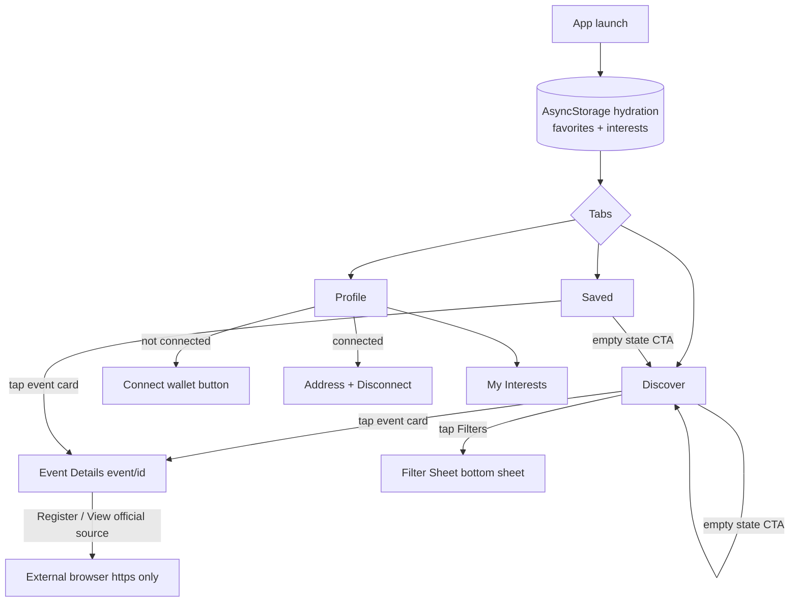
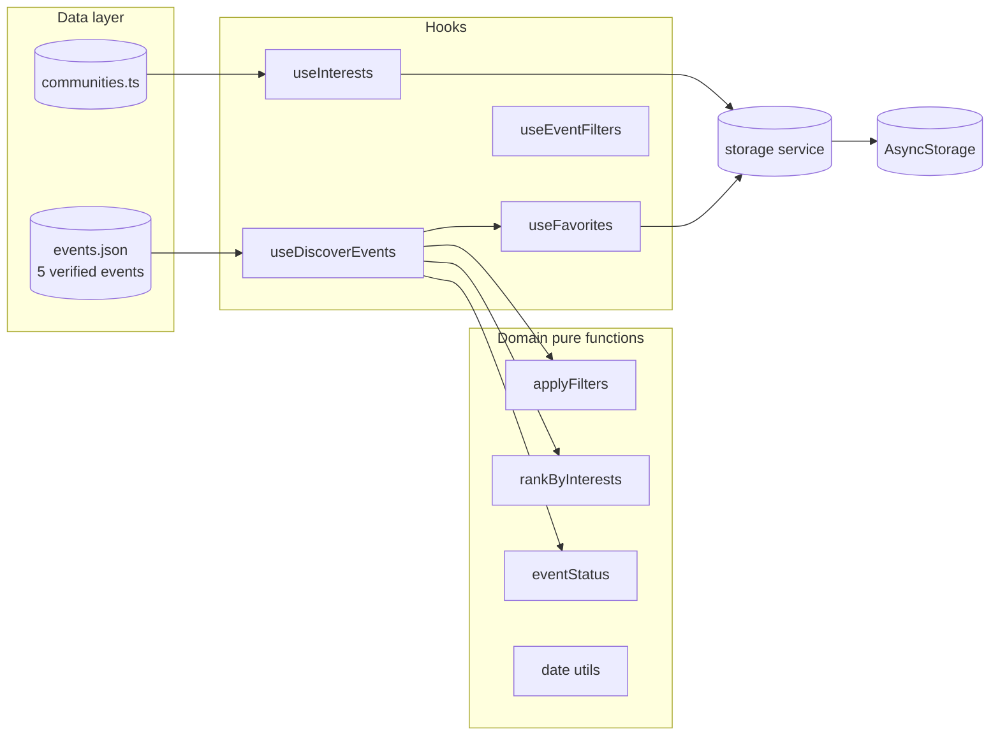

# Solana Events — P0 Product Features

## Summary

Mobile-first Android app to discover curated, verified Solana events, view their details, save them locally, and open official registration pages. Wallet connection via Mobile Wallet Adapter (MWA) on Seeker adds identity without gating any catalog feature. No backend, no real-time data, no on-chain reads.

Source of truth for scope: `docs/implementation-plan.md` (sections 2, 5, 6, 8, 9).

## Decisions

| Decision | Choice | Rationale |
| --- | --- | --- |
| Navigation | expo-router (starter) — tabs: Discover / Saved / Profile; routes: `event/[id]`, `interests` | Single navigation solution, starter convention preserved |
| Auth gate | Removed | Plan §8: wallet never blocks catalog. Tabs always reachable; wallet connect lives in Profile |
| Theme | Dark-only, token-based (`src/theme`) | Plan §7: one coherent finish; tokens avoid hardcoded colors |
| Storage | AsyncStorage via versioned-key service with safe JSON parse | Plan §9 keys `solana-events:favorites:v1`, `solana-events:interests:v1` |
| Wallet | `useMobileWallet()` from `@wallet-ui/react-native-web3js`, wrapped in `src/services/wallet.ts` | Plan §4: screens never call MWA directly |
| Tests | jest + jest-expo, pure domain/service logic only | TDD where logic lives; UI verified on-device per plan §11 |
| Storybook | Not installed | RN 0.83 + Expo 55 + expo-router + dev-client makes Storybook native setup high-risk 2 days before deadline; adds no user value; components validated on real devices per test matrix |
| Cluster | Fixed devnet endpoint, single network | Plan §3: no RPC usage in MVP; provider needs an endpoint to initialize |
| Transactions/airdrop/sign-message screens | Deleted | Plan §8 forbids transfer/SOL/signature flows in product UI |

## Navigation structure

Description: Root layout hydrates persisted state, then renders three tabs. Discover and Saved navigate to the shared Event Details route. Profile owns wallet connection and links to My Interests. External links leave the app only through the guarded link service.

## Data flow

Description: Screens consume hooks only. Hooks compose the static catalog with pure domain functions and persisted state. The storage service is the single Asyncstorage touchpoint; components never read storage directly.

## Wallet state machine

```mermaid
stateDiagram-v2
    [*] --> Disconnected
    Disconnected --> Connecting: Connect wallet pressed
    Connecting --> Connected: wallet authorizes (MWA)
    Connecting --> Disconnected: user cancels / no wallet
    Connected --> Disconnected: Disconnect pressed
    Connected --> Error: MWA error
    Error --> Disconnected: user acknowledges
    note right of Connected: only public address shown; no balance, no signing
```

Description: Every non-connected state keeps the full catalog usable. Cancellation returns silently to Disconnected. Errors show an explanatory message, never a crash.

## Persistence contract

Keys (plan §9): `solana-events:favorites:v1` → `string[]` of event ids, deduplicated, ids missing from the catalog ignored. `solana-events:interests:v1` → `{ topics: Topic[]; communityIds: string[] }`.

Read path: app start → hydrate → `hydrated` flag prevents Saved-list flash. Write path: mutate in-memory state → persist → surface persistence error to caller. Corrupt JSON → treated as empty, never crashes.

## Ranking rule

`score = 2 × |event.topics ∩ interest.topics| + 1 × |event.communityIds ∩ interest.communityIds|`; ties broken by `startAt` ascending. Pure function, unit tested.

## Filter rule

Different categories AND, same-category values OR. Case-insensitive substring search over title + organizer, local only.

## Verification

- `npm run typecheck`, `npm run lint:check`, `npm run test` green.
- Manual matrix per plan §11 on Android standard + Seeker (tracked in README test matrix).
- Events dataset: every entry carries `officialSourceUrl` and `lastVerifiedAt`; fixture data (prefix `fixture-`) excluded from production catalog.
