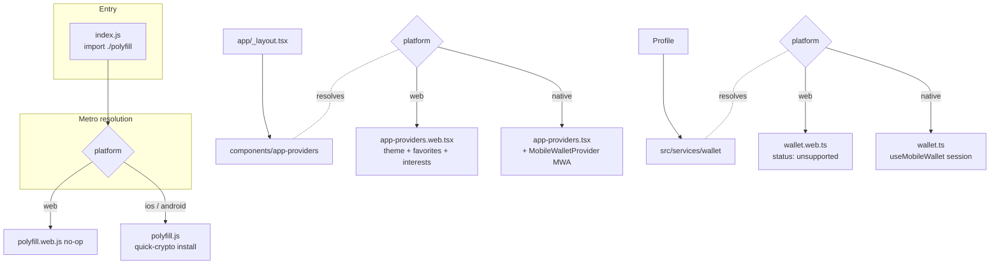
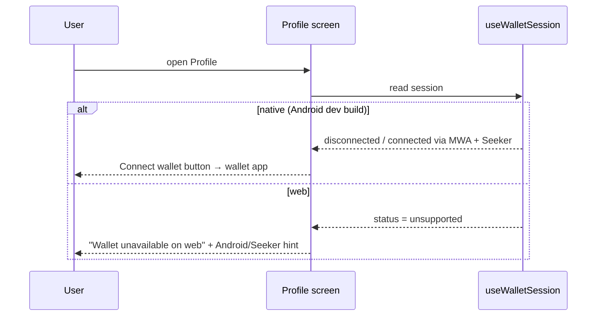

# Web Platform Support (Metro static web)

## Summary

Run the Expo SDK 55 app at `http://localhost:8081` as a Metro static web build without changing Android dev-client behavior or Mobile Wallet Adapter (MWA) support. Web users get the full event catalog (Discover, Saved, Event Details, Interests, external https links); wallet connection is reported as unavailable instead of simulated.

## Root cause

`app.json` already enabled `web.bundler: metro` + `output: static`, but `package.json` lacked `react-dom` and `react-native-web`, so the web bundle failed with `Unable to resolve module react-native-web/dist/exports/Platform`.

## Decisions

| Decision              | Choice                                                                                                                        | Rationale                                                                                                                                                                     |
| --------------------- | ----------------------------------------------------------------------------------------------------------------------------- | ----------------------------------------------------------------------------------------------------------------------------------------------------------------------------- |
| Web deps              | `npx expo install react-dom react-native-web` (19.2.0 / ^0.21.0)                                                              | SDK 55-compatible versions chosen by Expo, no SDK upgrade                                                                                                                     |
| File split pattern    | base file stays native + `.web` variant added                                                                                 | Matches existing repo convention (`hooks/use-color-scheme.ts` + `.web.ts`); Metro native resolution prefers base last, web prefers `.web` first — Android path byte-identical |
| Providers             | `components/app-providers.web.tsx` omits `MobileWalletProvider`, keeps `AppTheme` + `FavoritesProvider` + `InterestsProvider` | MWA is native-only; favorites/interests are local and must work on web                                                                                                        |
| Polyfill              | `polyfill.web.js` no-op; `polyfill.js` (quick-crypto) still resolved on native                                                | Browsers ship WebCrypto; RN needs quick-crypto                                                                                                                                |
| Wallet session        | `src/services/wallet.web.ts` returns permanent `unsupported` status                                                           | No fake wallet connection; UI states the Android/Seeker requirement                                                                                                           |
| Interests gate on web | Profile shows Communities + Manage interests when status is `connected` or `unsupported`                                      | Interests never require a wallet; native behavior unchanged (never `unsupported`)                                                                                             |
| `Alert.alert` on web  | `Platform.OS === 'web'` direct-reset path in interests screen                                                                 | `Alert.alert` is a no-op on react-native-web                                                                                                                                  |
| Expo Go               | Not supported                                                                                                                 | Custom dev client is required for MWA on Android                                                                                                                              |

## Platform resolution

Description: `index.js` and every shared import resolve through Metro platform extensions. Web gets no-op polyfill, provider stack without MWA, and a stub wallet session; native keeps the exact base files it already used.

## Wallet UX per platform

Description: Native flow unchanged. Web flow renders an informational card — no connect button, no simulated address — while Communities and Manage interests stay reachable because they are wallet-independent.

## Verification

- `npx expo export --platform web` — 11 static routes SSR without resolution errors; `dist/profile.html` contains "Wallet unavailable on web"; bundle contains zero `quick-crypto`/`MobileWalletProvider` references.
- `npx expo export --platform android` — Hermes bundle builds from unchanged native files.
- `npx expo start --web --clear` — dev server serves `http://localhost:8081`, `index.bundle?platform=web` returns 200.
- `npm run typecheck`, `npm run lint:check`, `npm test -- --runInBand` — all pass (61/61).
- On-device Android dev-client regression (Discover → Profile → Connect wallet) requires hardware; compile-level checks above cover the native path.

## Files

- `components/app-providers.web.tsx` (new)
- `src/services/wallet.web.ts` (new)
- `polyfill.web.js` (new)
- `src/services/wallet.ts` — `WalletStatus` gains `'unsupported'`
- `src/components/WalletStatusCard.tsx` — unsupported branch
- `app/(tabs)/profile.tsx` — interests gate includes `unsupported`
- `app/interests.tsx` — web-safe reset path
- `src/components/EventCard.tsx` — open/save targets are sibling Pressables inside a plain card View; nesting them rendered `<button>` inside `<button>` on web (invalid HTML, hydration error)
- `package.json` / `package-lock.json` — `react-dom`, `react-native-web`
