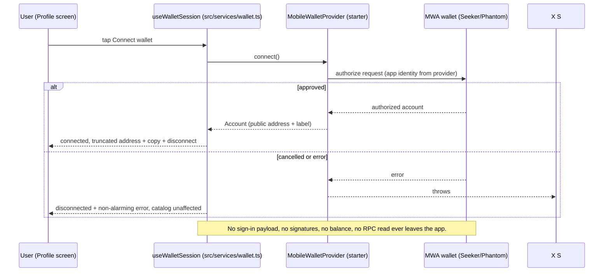

# P0 Hardening

## Summary

Three P0 gaps closed before release: (1) the wallet service now performs authorization-only MWA connection, (2) the release identity URI points at the real GitHub repository, and (3) every catalog event and registration URL was re-verified against its official page. Documentation was corrected to match installed versions and to state only real test results.

## Decisions

| Gap                  | Change                                                                                                                                            | Rationale                                                                                                                                                                                                                            |
| -------------------- | ------------------------------------------------------------------------------------------------------------------------------------------------- | ------------------------------------------------------------------------------------------------------------------------------------------------------------------------------------------------------------------------------------ |
| Wallet sign-in       | `useMobileWallet().signIn({ uri })` → `useMobileWallet().connect()` in `src/services/wallet.ts`                                                   | Plan §8: connect requests standard MWA authorization only; `signIn` is a Solana sign-in payload requiring a message signature flow. Identity (name/URI) already flows from `MobileWalletProvider` in `components/app-providers.tsx`. |
| Forbidden operations | None present: no `signMessage`, `signTransaction`, `signAndSendTransaction`, balance reads, or RPC usage                                          | Plan §3 security constraints; enforced by a source-level unit test so regressions fail CI.                                                                                                                                           |
| Release identity URI | `AppConfig.uri` → `https://github.com/SanseDev/solana-events` (matches git remote `SanseDev/solana-events`)                                       | Plan §14: wallet displays the requesting app link; placeholder URL must not ship.                                                                                                                                                    |
| Android package ID   | Left as `com.anonymous.solana_events_app`                                                                                                         | Owner decision required — the package ID cannot change after Play Store release. Recorded as a manual blocker.                                                                                                                       |
| Catalog verification | All 6 events × official source + registration URL fetched and cross-checked on 2026-10-08; `lastVerifiedAt` bumped only where evidence matched    | Plan §5: no invented organizer, dates, venue, URLs, or registration status.                                                                                                                                                          |
| Integrity tests      | Extended: https registration URLs, required non-empty fields, enum membership, explicit ISO offsets on all datetimes, `lastVerifiedAt` date shape | Catalog bugs should fail tests, not reviewers.                                                                                                                                                                                       |
| Docs truthfulness    | `docs/versions.md` reflects installed SDK 57 stack; README states real results and marks all manual items pending                                 | Plan §13: never claim hardware testing, APK, video, or deck without evidence.                                                                                                                                                        |

## Wallet connection flow (authorization-only)

Description: the Profile screen talks only to `useWalletSession`. The service calls `connect()` on the starter's `useMobileWallet` hook, which performs the standard MWA authorization using the app identity configured once in `MobileWalletProvider`. Cancel and error paths keep the app fully usable; nothing beyond the public address and label is retained.

## Catalog verification evidence (2026-10-08)

| Event                        | Official source              | Confirmed by fetch                                              | Registration URL               |
| ---------------------------- | ---------------------------- | --------------------------------------------------------------- | ------------------------------ |
| Solana Breakpoint 2026       | solana.com/breakpoint        | Nov 15–17 2026, Olympia London, tickets on sale                 | luma.com/breakpoint2026 (open) |
| Solana Hacker House — London | luma.com/london-hh-26        | Nov 1–12 2026, London, free with approval                       | same URL (open)                |
| Solana Intelligence Summit   | luma.com/intelligence-summit | Nov 13 2026 10:00–18:00, Somerset House, request to join        | same URL (open)                |
| Solana Summit India          | luma.com/solana-summit-india | Nov 2 2026 10:00–19:00 IST, Mumbai, approval-based              | same URL (open)                |
| IslandDAO v5                 | luma.com/6laijuyn            | Oct 19 – Nov 11 2026, Florianópolis; Luma redirects to official | islanddao.org (open)           |
| solanaStartupConnectGH       | luma.com/nx9ps6ud            | Oct 15–16 2026, Accra Digital Centre, approval-based            | same URL (open)                |

## Safety guard tests

`src/services/__tests__/wallet.test.ts` reads the service source and fails if it references `signIn`, `signMessage`/`signMessages`, `signTransaction`/`signTransactions`, `signAndSendTransaction(s)`, `getBalance`, `getAccountInfo`, `requestAirdrop`, or `sendRawTransaction`; asserts screens (`app/`, `src/components/`) never import `useMobileWallet`; and pins `AppConfig.uri` to the real repository. These are source-level guards — no device or MWA success is faked; on-device wallet flows remain manual test-matrix items.
