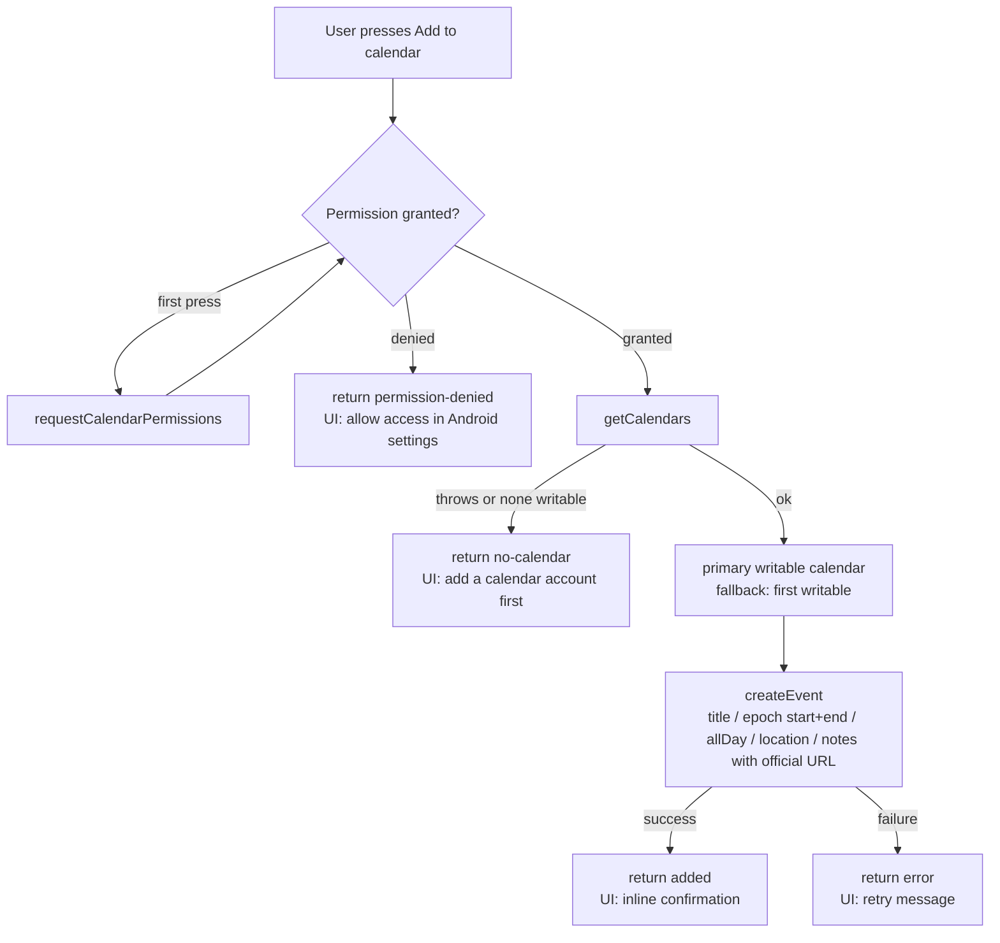

# P1 Add to Calendar (Event Details)

## Summary

Add a P1 `Add to calendar` action to the Event Details screen so an attendee can copy a verified event into the device's default calendar. Follows plan §6 (`P1 : Add to calendar`) and §10 Milestone 5 item 2: only after P0 is fully verified, with correct timezone handling, denied-permission handling, and a clear fallback. The light interests ranking (the other P1 line item) already shipped with P0 via `src/utils/ranking.ts` (tested) and is not touched here.

## Decisions

| Decision             | Choice                                                                                                    | Rationale                                                                                                                |
| -------------------- | --------------------------------------------------------------------------------------------------------- | ------------------------------------------------------------------------------------------------------------------------ |
| Dependency           | `expo-calendar` ~57.0.5 (installed via `npx expo install`)                                                | Plan §3 explicitly allows the Expo calendar package once P0 is done; avoids hand-rolled Android intents                  |
| API generation       | SDK 57 modern API: `requestCalendarPermissions`, `getCalendars`, `ExpoCalendar.createEvent`               | Legacy `*Async` names are deprecated in SDK 57; `getDefaultCalendar` is iOS-only on Android                              |
| Entry point          | Secondary outline button on Event Details, between `Register` and `Official source`                       | Matches plan §6 layout; not a primary CTA — registration still happens on the organizer page                             |
| Write target         | Primary writable calendar, fallback first writable (`getCalendars` + `isPrimary`/`allowsModifications`)   | Android exposes no single default calendar (SDK 57 docs); no picker, no reading existing events, no reminders            |
| Permission flow      | `requestCalendarPermissions()` at button press, never at app start                                        | Permission is requested in context; denial returns `permission-denied` and the UI explains the Android settings fallback |
| Timezone correctness | `Date.parse` of the offset-explicit ISO strings → epoch-based start/end                                   | `startAt`/`endAt` carry explicit UTC offsets (plan §5), so epochs are unambiguous regardless of device timezone          |
| `allDay` events      | `allDay: true` with midnight-anchored instants                                                            | Sources that publish date-only spans (e.g. Breakpoint) produce proper multi-day all-day entries                          |
| Event payload        | title, start/end epochs, `allDay`, location (`Online` fallback), notes = short description + official URL | Notes carry the trusted `https` link into the calendar entry so registration stays one tap away                          |
| Ended events         | Button hidden when `getEventStatus() === 'ended'`                                                         | Adding a past event to a calendar has no value; keeps detail consistent with Discover/Saved behavior                     |
| Web platform         | `src/services/calendar.web.ts` returns `'unsupported'`; button hidden via `Platform.OS` check             | Mirrors `wallet.web.ts` pattern (spec 20261006); no simulated success on web                                             |
| UI feedback          | Inline `adding` busy state, inline `added` confirmation (disabled), Alerts for denial/failure             | No toast dependency; Alerts match existing detail-screen error style; `Alert.alert` is only reached on native            |
| Safety               | Service is the only module importing `expo-calendar`; screens go through it                               | Same isolation rule as the wallet layer (plan §4), guarded by a source-safety test                                       |

## Result contract

`src/services/calendar.ts` exposes a pure payload mapper and one async operation:

```ts
export type CalendarAddResult = 'unsupported' | 'added' | 'permission-denied' | 'no-calendar' | 'error'
```

- `added` — event created in the primary (or first writable) calendar.
- `permission-denied` — user declined the runtime permission; UI shows the settings fallback message.
- `no-calendar` — calendar list unreadable or no writable calendar account exists (common on fresh emulators).
- `error` — `createEvent` failed; UI invites a retry, catalog remains fully usable.

## Flow



Description: pressing the button requests the calendar permission in context, then writes one event to the primary writable calendar (Android has no single default calendar in the SDK 57 API). Every failure path returns a distinct result so the screen can explain the fallback instead of blocking or crashing; the catalog and all other actions stay available.

## Platform resolution

```mermaid
flowchart TD
    D[app/event/[id].tsx] --> S{platform}
    S -->|web| SW[calendar.web.ts<br/>addEventToCalendar → unsupported]
    S -->|android / ios| SN[calendar.ts<br/>expo-calendar adapter]
    SN --> X[(expo-calendar native module)]
```

Description: Metro platform extensions resolve the import. Web renders no button (`Platform.OS === 'web'`), so the web stub exists purely to keep the module graph resolvable and honest — the same convention as `wallet.web.ts`.

## Verification

- `npx tsc --noEmit` — passes.
- `npm run lint:check` — passes, no warnings.
- `npm test` — new suite `src/services/__tests__/calendar.test.ts` covers: payload mapping (epochs, `allDay`, location fallback, notes with official URL), permission denial, unreadable/empty calendar list, primary-calendar preference, first-writable fallback, unexpected write failure, web stub, and a source-safety guard that no screen imports `expo-calendar` directly. Full suite green.
- Native runtime behavior (permission dialog, real calendar write, denial fallback) requires a rebuilt dev client or APK on hardware — recorded as manual items in `README.md`.

## Files

- `src/services/calendar.ts` (new) — result contract, pure `buildCalendarDetails` mapper, `addEventToCalendar`.
- `src/services/calendar.web.ts` (new) — `unsupported` stub.
- `src/services/__tests__/calendar.test.ts` (new) — unit + source-safety tests.
- `app/event/[id].tsx` — `Add to calendar` outline button with busy/success/denied states; hidden for ended events and on web.
- `app.json` — `expo-calendar` plugin entry with permission string.
- `package.json` / `package-lock.json` — `expo-calendar` dependency.
- `README.md`, `docs/stories/20261005-p0-user-stories.md` — P1 scope and story updates.
