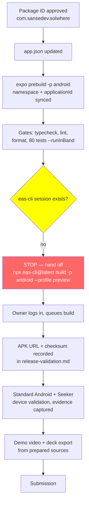

# P0 Release Submission

## Summary

Final release-identity and submission groundwork: the Android package ID was owner-approved and applied (`com.sansedev.solwhere`), release configuration was verified to produce an installable APK, all automated gates were re-run, and the truth-tracking artifacts for hardware validation, demo video, and pitch deck were created with every unperformed item marked `pending`. No APK build, device test, screenshot, video, or deck export is claimed — none has happened.

## Decisions

| Item                | Choice                                                                                    | Rationale                                                                                            |
| ------------------- | ----------------------------------------------------------------------------------------- | ---------------------------------------------------------------------------------------------------- |
| Android package ID  | `com.sansedev.solwhere` (owner choice over suggested `com.sansedev.solanaevents`)         | Immutable after Play Store publication; resolved the blocker recorded in `20261008-p0-hardening.md`. |
| APK channel         | EAS cloud build, `preview` profile (`distribution: internal`, `android.buildType: "apk"`) | Universal APK installable on any Android device incl. Seeker; no store submission.                   |
| Production profile  | Untouched; no `eas submit` run                                                            | Release plan forbids submission without explicit approval.                                           |
| EAS build execution | Stopped before build: no `eas-cli` session exists (`~/.eas-cli` absent)                   | Auth check must not open browsers or change state; exact command handed to owner.                    |
| Evidence policy     | `docs/release-validation.md` with every item `pending` + evidence columns                 | Plan §13: never claim hardware test, APK, video, or deck without evidence.                           |
| Deck artifact       | `docs/pitch-deck.md` markdown source (7 slides)                                           | Repo has no established deck format; markdown is the source of truth until export.                   |

## Release pipeline state

Description: Solid path shows completed work through the automated gates. The pipeline halts at the EAS auth check (no stored session); everything from the cloud build onward stays owner-action and is tracked as `pending` in `docs/release-validation.md` and the README submission checklist.

## Verification record (2026-10-08)

| Gate      | Command                   | Result                                                                                                                                 |
| --------- | ------------------------- | -------------------------------------------------------------------------------------------------------------------------------------- |
| Typecheck | `npm run typecheck`       | pass, no output                                                                                                                        |
| Lint      | `npm run lint:check`      | pass, no warnings                                                                                                                      |
| Format    | `npm run format:check`    | pass                                                                                                                                   |
| Tests     | `npm test -- --runInBand` | 8 suites, 80 tests, all pass                                                                                                           |
| Prebuild  | `npm run android:build`   | regenerated `android/` (git-ignored) with `namespace`/`applicationId` = `com.sansedev.solwhere`; zero stale `com.anonymous` references |

## Artifacts created

- `docs/release-validation.md` — device test checklist (standard Android, Seeker/Seed Vault, standalone launch), build-under-test fields, screenshot capture plan.
- `docs/demo-script.md` — timed 60–90s demo beats incl. honest NFT-limitation close.
- `docs/pitch-deck.md` — 7-slide source: problem, user, flow, mobile/Seeker value, authorization-only security, offline architecture, roadmap/judging fit.
- README — package ID, exact build command, real build status, artifact links, submission checklist.

## Not done (owner actions)

1. `npx eas-cli@latest login`, then `npx eas-cli@latest build -p android --profile preview`; record build URL/ID, APK URL, SHA-256.
2. Install APK on standard Android + Seeker; fill `docs/release-validation.md` with real results and evidence.
3. Capture screenshots per checklist into `docs/evidence/`.
4. Record demo video from `docs/demo-script.md`; export deck from `docs/pitch-deck.md`.
5. Submit only when the checklist above is green.
