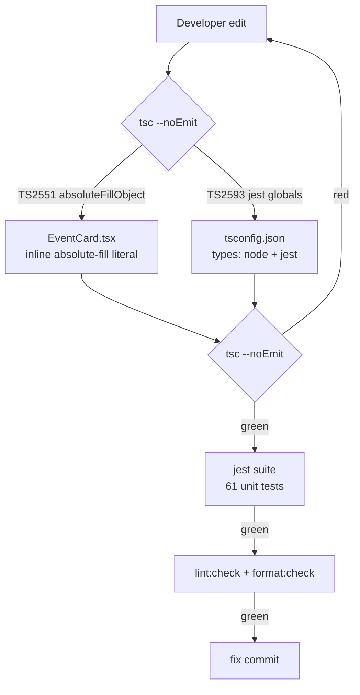

# Typecheck Gate Restoration

## Summary

`npm run typecheck` (`tsc --noEmit`) failed with two error classes after the Expo SDK 57 upgrade path, blocking the Milestone 1 quality gate and `npm run ci`. This spec documents the root causes and the minimal fixes that turn the gate green again without behavior changes.

## Failures observed

```text
src/components/EventCard.tsx(99,19): error TS2551: Property 'absoluteFillObject'
  does not exist on type 'typeof StyleSheet'. Did you mean: 'absoluteFill'?

src/**/__tests__/*.test.ts: error TS2593: Cannot find name 'describe'/'it'.
  error TS2304: Cannot find name 'expect'.
```

## Root cause

| Error                | Cause                                                                                                                                                                                                                                |
| -------------------- | ------------------------------------------------------------------------------------------------------------------------------------------------------------------------------------------------------------------------------------ |
| `absoluteFillObject` | React Native 0.86.3 type definitions export only `absoluteFill` (`StyleSheet.d.ts:129`); `absoluteFillObject` was removed from the public `typeof StyleSheet` type while the runtime helper had already been deprecated.             |
| Missing jest globals | `@types/jest@29` is installed but was never referenced: `tsconfig.json` sets no `compilerOptions.types`, so only ambient auto-included `@types/*` packages are visible. Jest globals are ambient, so test files failed to typecheck. |

## Decisions

| Decision                   | Choice                                                                          | Rationale                                                                                                                                                                  |
| -------------------------- | ------------------------------------------------------------------------------- | -------------------------------------------------------------------------------------------------------------------------------------------------------------------------- |
| Absolute-fill in EventCard | Inline literal `{ position: 'absolute', top: 0, right: 0, bottom: 0, left: 0 }` | Runtime-equivalent to the old spread; zero dependency on a deprecated/removed StyleSheet export; identical layout for the open-target overlay.                             |
| Jest globals               | `"types": ["node", "jest"]` in `tsconfig.json`                                  | `node` must stay because `app/_layout.tsx` uses the CommonJS `require` global from `@types/node`; adding `jest` exposes `describe`/`it`/`expect` ambient globals.          |
| No component render test   | Not added                                                                       | The fix is a type-level/mechanical style change; the regression is permanently caught by the `tsc --noEmit` gate itself. Adding react-test-renderer infra is out of scope. |
| Storybook                  | Not installed                                                                   | No new component, no behavior change; only a style literal and compiler config changed.                                                                                    |

## Verification gate



Description: every edit re-enters the `tsc --noEmit` gate; the two documented fixes clear the only red paths, after which the existing jest suite and lint/format checks must pass before committing.

## Result

- `npm run typecheck` green.
- `npm test` green (all existing suites).
- No runtime behavior change on Android, Seeker, or web.
