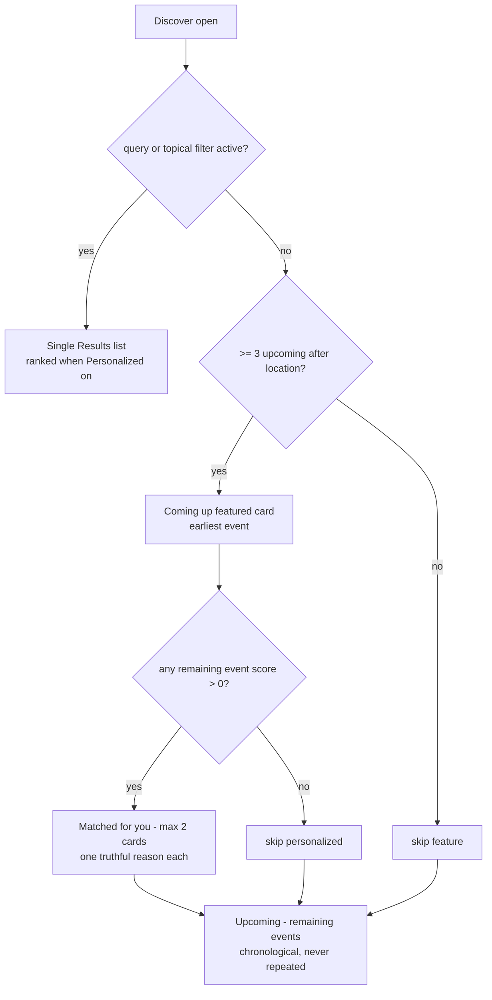
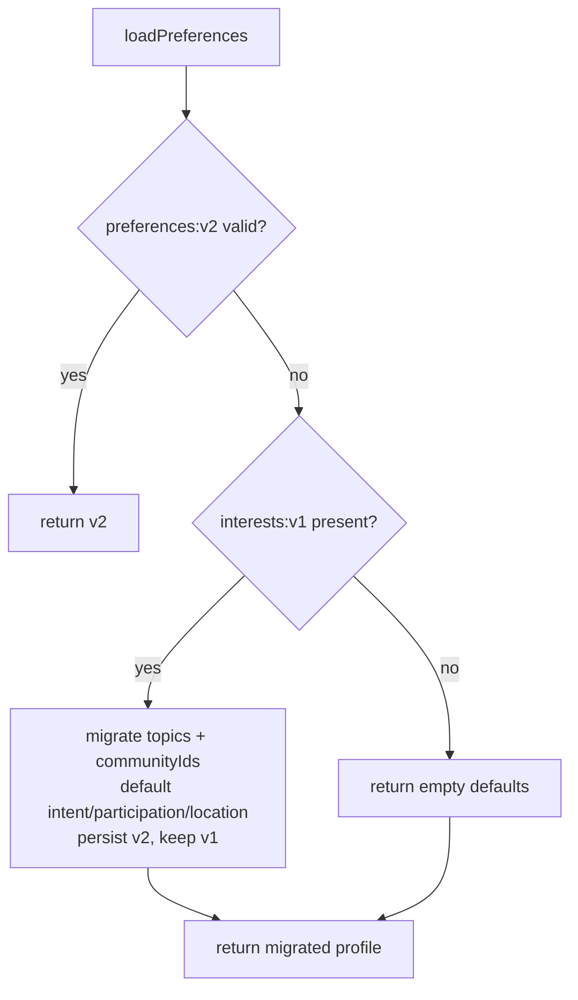
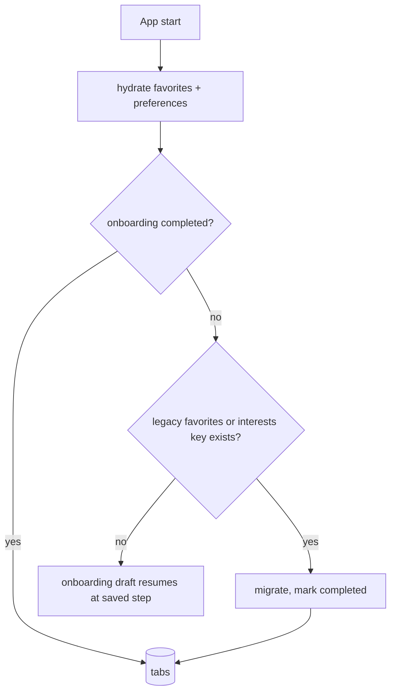

# Solwhere Redesign — Design System, Discover, Preferences, Onboarding

## Summary

Ship the local-first Solwhere redesign across three milestones: (M1) semantic design
tokens, shared UI primitives, and a duplicate-free Discover screen with truthful
personalization; (M2) a persisted `PreferenceProfile` with v1→v2 storage migration and a
three-step skippable onboarding flow; (M3) propagation of the system to Event Details,
Saved (date-grouped), and Profile (preferences ungated from wallet). No new dependency,
no Expo SDK change, no Android application ID / URL scheme / storage-key change.

## Scope

- Rename visible product strings to **Solwhere** only (app name, wallet identity name,
  screen copy). Package `com.sansedev.solwhere`, scheme `solanaevents`, and storage keys
  `solana-events:*` stay unchanged.
- Personalization is transparent: a reason is shown only when a persisted choice
  actually matches the event. Zero-score events never appear under a personalized label.
- Wallet stays optional and authorization-only; its copy must not claim recommendation,
  NFT, ticket, or attendance benefits.
- Saving is a personal shortlist; copy never implies registration or RSVP.
- Excluded (per plan §10): NFT suggestions, community pages, backend/catalog sync,
  reminders, notifications, GPS, share (until after M3), new images/fonts/icons.

## M1 — Design tokens, primitives, Discover

### Token replacement

`src/theme/colors.ts` becomes the semantic palette (canvas `#090D18`, canvasRaised
`#0D1322`, surface `#12192A`, surfaceRaised `#182238`, surfacePressed `#202C46`,
borderSubtle `#26334D`, borderStrong `#3A4A6B`, textPrimary `#F4F7FF`,
textSecondary `#B6C1D8`, textTertiary `#7F8CA8`, accent `#9B8CFF`,
accentPressed `#7C6DE0`, accentMuted `#29234C`, success `#59D7A6`,
warning `#F3BF6B`, danger `#FF8295`, focusRing `#C3B9FF`). Spacing gains 40 and
`radius` becomes `sm=10 / md=14 / lg=18 / pill=999`. Typography becomes
display 32/38 700, pageTitle 28/34 700, detailTitle 26/32 700, sectionTitle 18/24 700,
body 16/24, bodyCompact 14/20, label 13/18 600, overline 11/14 700 +0.8 tracking.
Touch targets: 48 minimum, primary buttons 52, chips 36. All screens consume tokens —
no hard-coded palette values in screens.

### Filter model (categories AND, values inside a category OR)

```ts
interface EventFilters {
  topics: Topic[]
  formats: EventFormat[]
  attendance: AttendanceMode[] // empty = any
  dateRange: 'any' | 'this_week'
  location: LocationPreference | null
}
```

- `This week`: events overlapping `[now, end of the 7th local calendar day]`.
- `Online` quick control writes `attendance = {online, hybrid}` (union with existing
  selection); incompatible sheet selections intersect to zero results, never fake data.
- `Hackathons` quick control toggles `hackathon` inside `formats` (OR).
- Location filters by exact catalog `city + country`. Location constrains results in
  both layouts; the Results-vs-default layout switch ignores location so the featured
  section can honor the location constraint.

### Scoring and truthful reasons

```ts
interface EventRecommendation {
  event: Event
  score: number
  reasonKeys: string[] // 'topic:<t>' | 'community:<id>' | 'intent:<i>', empty on zero score
}
```

Weights keep today's contract (+2 topic, +1 community) and add +1 per matching intent
rule: `learn` → workshop format or developers topic; `meet_people` → meetup/community
format with in-person/hybrid attendance; `hackathons` → hackathon format;
`communities` → event has community IDs. Sort: score desc, then `startAt` asc.

### Discover layout



Description: Discover shows either a single filtered Results list, or the default
layout where the featured `Coming up` card, the `Matched for you` section (only
nonzero scores, max two, deduplicated from the remainder), and the chronological
`Upcoming` list partition the catalog without duplicates. `Personalized` is a sort-only
quick control, disabled until at least one profile answer produces a nonzero match.

## M2 — Preference profile, migration, onboarding

### Domain types (added to `src/domain/event.ts`)

```ts
type Intent = 'learn' | 'meet_people' | 'hackathons' | 'communities'
type ParticipationPreference = 'online' | 'in_person' | 'both'
interface LocationPreference {
  city: string
  country: string
}
interface PreferenceProfile {
  intent: Intent[]
  topics: Topic[]
  communityIds: string[]
  participation: ParticipationPreference
  location: LocationPreference | null
}
```

### Storage



Description: `loadPreferences()` prefers a valid `solana-events:preferences:v2`; falls
back to parsing legacy `solana-events:interests:v1` into a v2 profile; corrupt data
degrades to safe defaults. v1 is never deleted. New key
`solana-events:onboarding:v1` stores `{ completed, step, draft }`.

### Launch decision



Description: hydration completes before the root chooses onboarding versus tabs, so
returning users never flash Discover or get rerouted into onboarding. Existing
installations count as returning users.

### Onboarding steps

| Step                              | Draft field                 | Effect after completion                               |
| --------------------------------- | --------------------------- | ----------------------------------------------------- |
| Intent (multi)                    | `intent[]`                  | +1 per matching intent rule, named reasons            |
| Topics (multi)                    | `topics[]`                  | +2 topic score, named reasons                         |
| Participation + optional location | `participation`, `location` | default Discover availability constraint and location |

Selection is optional per step; Skip writes the default profile plus the completed
marker; Android Back edits the prior step and asks before abandoning a draft on step 1.
Draft is persisted after every change so kill/relaunch resumes in place.

`src/hooks/usePreferences.tsx` replaces `useInterests.tsx` as the single provider
(registered in `components/app-providers.tsx`); interests screen is replaced by a
shared `PreferenceEditor` used by onboarding and Profile.

## M3 — Details, Saved, Profile

- Details: 16:9 cover/fallback under a safe-area back button; format/attendance
  overlines; persistent bottom action bar with primary `Register` / `View official
source` / disabled `Registration closed`; secondary row Save + Add to calendar.
  Existing HTTPS guard, date/timezone, registration-state, and calendar contracts
  unchanged.
- Saved: `Upcoming` partition grouped by the device-timezone date of each start
  (`Today`, `Tomorrow`, or `Tue, 15 Nov`) ascending, then `Past events` descending.
  Event timestamps are converted into the device timezone before grouping and
  labeling — the device-local "today" is never compared against a raw ISO
  event-local date. Event Details keeps the event's own timezone explicit.
  Compact cards without recommendation reasons; empty state with `Explore events` CTA.
- Profile: `Your preferences` card always visible (summary + `Edit preferences` +
  followed-communities count) above an independent `Wallet` section; corrected
  disconnected-wallet copy that never claims personalization.
- Onboarding completion is a two-write transaction (profile, then the completed
  marker): navigation to tabs happens only after both persist; on failure the
  flow stays, the draft is preserved, and a retryable error shows. A profile
  write without the marker relaunches into onboarding — never a silent
  completion. Android Back persists the previous step together with the draft.
- `Personalized` availability requires a nonzero-score match inside the current
  eligible results (search + filters + location), not merely nonempty profile
  answers; selecting it alone renders one ranked duplicate-free results list
  with truthful reasons, and a selection that stops matching renders as
  inactive rather than misleadingly selected.

## Non-goals / guards

- Never gate local preferences behind wallet state.
- Never render an event twice in Discover; never label zero-match events personalized.
- Never imply saving registers, tickets, or RSVPs.
- Keep the pure functions pure: filtering and grouping operate on the catalog with an
  injected `now` for testability.

## Test plan

- `src/domain/__tests__/filters.test.ts` — attendance arrays, this-week window,
  location exactness, quick-control combinations, AND/OR invariants.
- `src/utils/__tests__/ranking.test.ts` — weights, intent rules, reason keys,
  deduplication, zero-score, tie-breaks.
- `src/services/__tests__/storage.test.ts` — v2 round-trip, v1 migration, onboarding
  draft parsing, corrupt-input defaults, legacy detection for the launch decision.
- `src/utils/__tests__/dateGroups.test.ts` — Saved partitions, device-timezone
  labels, midnight boundaries, and same-instant/different-offset grouping.
- `src/services/__tests__/storage.test.ts` — onboarding completion rejection
  and partial-failure relaunch behavior.
- Existing calendar/wallet/external-link/catalog tests stay green.
