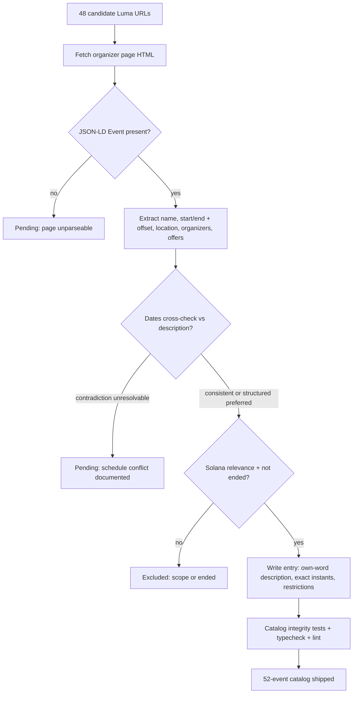

# Solwhere Catalog Expansion — October 2026

## Summary

Grew `src/data/events.json` from 6 to 52 curated events by processing a researched
queue of 48 candidate organizer-published pages (Luma), verifying each against its
page's structured metadata (schema.org JSON-LD) and rendered description before
import. 46 candidates were added, 1 kept pending (unresolvable schedule
contradiction), 1 excluded as out of editorial scope. One new community (`la-familia`)
was added; all other new events map to existing community ids or none. No schema,
validation, or artwork changes were needed — the additions were designed to satisfy
the existing strict catalog rules.

Per-candidate evidence, dates, restrictions, and contradiction flags live in
`docs/catalog-audit-2026-10-12.md`.

## Decisions

| Decision                                | Choice                                                                                                  | Rationale                                                                                                         |
| --------------------------------------- | ------------------------------------------------------------------------------------------------------- | ----------------------------------------------------------------------------------------------------------------- |
| Verification source                     | Organizer Luma page JSON-LD + full page description                                                     | JSON-LD carries the exact instants and offsets Luma renders; descriptions cross-check them                        |
| Contradiction policy                    | Flag in audit doc; prefer structured metadata unless prose is explicitly clearer (e.g. attendance mode) | Neither silently choosing values nor blocking imports on fixable prose staleness                                  |
| Wall-time recurrence entries            | One catalog entry per published occurrence URL with occurrence-specific id                              | 12 VibeStation pages are distinct published sessions; no recurrence generation from patterns                      |
| Superteam regional chapters             | Reuse existing `superteam` community id                                                                 | Model has one Superteam community; chapters are not separate communities yet                                      |
| New communities                         | Added `la-familia` only                                                                                 | La Familia runs a recurring flagship event; one-off hosts (Jito, Capvise, BackersStage…) stay as plain organizers |
| Ledger OP3N                             | Excluded                                                                                                | General digital-security event, not a Solana-ecosystem event; single Solana Labs speaker is adjacent, not core    |
| CodeCup                                 | Pending                                                                                                 | Structured dates (Nov 8–17) conflict with the description (day event Nov 15 at Olympia); schedule unverifiable    |
| Superteam Canada "Community Call" traps | Pending (not imported)                                                                                  | luma.com/8uhc300o and sejn139p: structured Nov/Dec 2026 dates vs description "Thursday, Jul 3rd"                  |
| Ended cutoff                            | Use actual verification instant (2026-10-12 ~11:38 UTC)                                                 | Joe Takayama office hours were ongoing at verification time and were added; status logic marks ended events       |

## Verification pipeline

Description: Every candidate page is fetched, its structured Event metadata extracted,
and its description cross-checked. Contradictions the organizer page cannot resolve
become documented pending entries, never guessed values. Verified, relevant, not-ended
events are written into events.json with occurrence-specific ids, then the existing
integrity tests gate the import.

## Checks performed

- Unique ids, explicit-offset ISO timestamps, `endAt > startAt`, https-only URLs,
  known topics/formats/attendance modes/community ids — enforced by
  `src/data/__tests__/eventCatalog.test.ts` and re-asserted locally with a JSON
  script (52/52 pass).
- Cross-checks: luma.com/BP-SideEvents contains all 16 imported Breakpoint-week
  pages; solana.com/events lists Breakpoint, Hacker House, Demo Day, and Scale or Die;
  au.superteam.fun anchors match structured dates for the four Superteam AU items.
- `npm test`, `npm run typecheck`, `npm run lint:check`, `npm run format` all pass.

## Notes for the next expansion

- Re-check `luma.com/ol25ta77` (CodeCup), `luma.com/8uhc300o`, `luma.com/sejn139p`
  for corrected schedules, then import if resolved.
- Vancouver VibeStation Nov 6 page publishes a `-07:00` offset although PST (`-08:00`)
  normally applies after 2026-11-01; the published instant was kept verbatim and the
  anomaly flagged in the audit doc.
- "NO VibeStation due to Breakpoint" pages are cancellation notices, never events.
